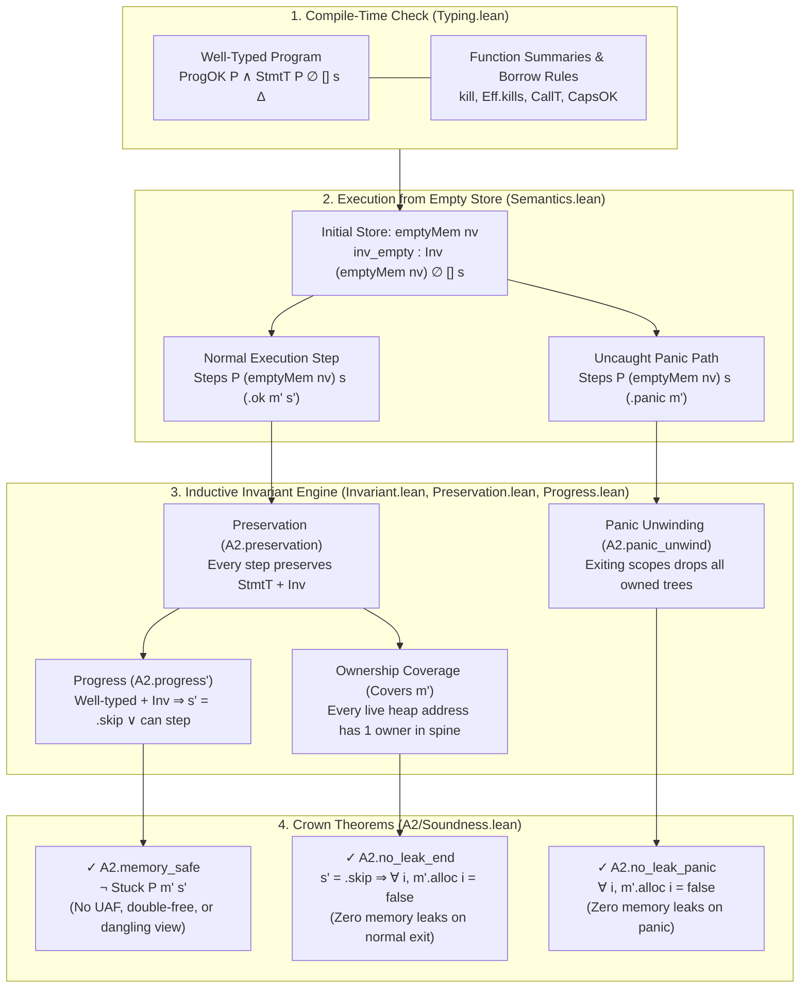
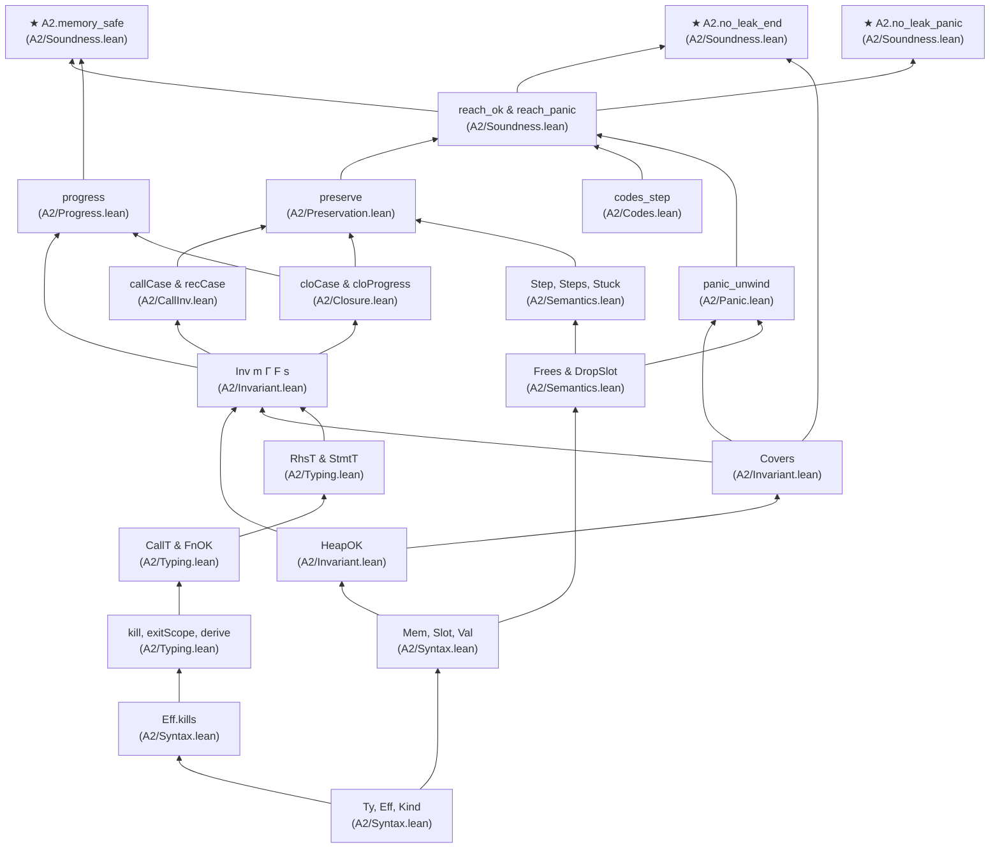

# Visual Blueprint of the Lean 4 Soundness Proof (`formal/`)

> **Interactive Explorer:** You can also explore this proof interactively (with a step-by-step memory & borrow-checker simulator, clickable theorem dependency graph, and searchable soundness-hole corpus) on **[nurl-lang.org/docs/formal-verification](https://nurl-lang.org/docs/formal-verification)**.

* **Toolchain:** `leanprover/lean4:v4.35.0` (zero external dependencies; standard axioms `propext`, `Classical.choice`, `Quot.sound` only; `0` `sorry`s)
* **Phase A2 (Full Single-Threaded Calculus + Leak Freedom):** **28 modules**, **20,757 lines of Lean 4**, **926 theorems**, **1160 total declarations**
* **Phase A1 (Core Calculus):** **22 modules**, **9,571 lines of Lean 4**, **449 theorems**, **613 total declarations**
* **Soundness Corpus ([`corpus/map.tsv`](corpus/map.tsv)):** **358 hole probes** (70 in A1, 185 in A2, 33 in A3, 70 in B)

---

## 1. For Everyone: What Does the Proof Actually Prove?

In one sentence: **If a safe NURL program passes the ownership and borrow checker (`StmtT`), running it can never read freed memory, free the same memory twice, read through a view whose buffer reallocated, or leak a single heap allocation — whether the program finishes normally or unwinds from a panic.**



### How the Calculus Models Memory Bugs as `Stuck`
Rather than axiomatizing memory safety after the fact, [`A2/Semantics.lean`](A2/Semantics.lean) requires every memory operation to check validity before stepping:
1. **No Use-After-Free:** Reading or mutating a `Vec` node at address `c` or view buffer `d` requires `m.alloc c = true` / `m.alloc d = true`. If `c` was freed, no `Step` rule applies — the state is `Stuck`.
2. **No Double-Free:** `Frees` requires every freed address to have `alloc c = true` before setting it to `false`, and `HeapOK` proves all owned trees are pairwise disjoint.
3. **No Dangling Views on Reallocation:** `vec_push` allocates a **fresh** buffer address `m.nid` and marks the old buffer `d` as `alloc d = false`. Any surviving `Val.view d off len` pointing to the old buffer `d` would immediately become `Stuck` on read — so `StmtT.push` must prove via `kill .realloc` that no such view is still `live`!
4. **No Memory Leaks:** `Covers m` asserts that every address `i` with `m.alloc i = true` lies inside the tree of some active owner binding in `s.spine`. When the program reaches `.skip` (or unwinds via `panic_unwind`), `s.spine` is empty, forcing `m'.alloc i = false` for every `i`.

---

## 2. The Effect & Invalidation Lattice (`Eff.kills`)

Every mutating operation on a root binding `r` has an effect `e : Eff` ordered by `none < realloc < drop < replace`. The function [`Eff.kills`](A2/Syntax.lean#L125-L135) determines which dependent bindings in context `Γ` are invalidated (`live := false`):

| Operation on `r` | Effect `e : Eff` | Kills `.view` (`Slice` / `s`)? | Kills `.inner` (`vec_at` borrow)? | Kills `.self` (handle borrow)? | Kills `.name b t` (closure capture)? |
|---|---|---|---|---|---|
| Read (`vec_len`, `in` param) | `.none` (rank 0) | No | No | No | No |
| Grow (`vec_push r x`) | `.realloc` (rank 1) | **Yes** (buffer moves) | No (elements stay intact) | Only if `r` holds views (`hv`) | No |
| Pop (`vec_pop r`) | `.drop` (rank 2) | **Yes** | **Yes** (element may drop) | Only if `r` holds views (`hv`) | No |
| Move / `=` / `vec_free` / scope end | `.replace` (rank 3) | **Yes** | **Yes** | **Yes** | **Yes** (at `exitScope`) |

---

## 3. Theorem Blueprint Graph (Landmark Definitions & Theorems)



---

## 4. Phase A2 Module Dependency DAG (28 Modules)

```mermaid
flowchart BT
  Basic["Basic<br/>(268L, 22 thms)"]
  Bind["Bind<br/>(188L, 4 thms)"]
  Call["Call<br/>(2746L, 136 thms)"]
  CallInv["CallInv<br/>(510L, 19 thms)"]
  CallMem["CallMem<br/>(938L, 43 thms)"]
  Closure["Closure<br/>(2501L, 95 thms)"]
  Codes["Codes<br/>(325L, 26 thms)"]
  Ctx["Ctx<br/>(202L, 22 thms)"]
  Frame["Frame<br/>(380L, 21 thms)"]
  Heap["Heap<br/>(173L, 13 thms)"]
  Invariant["Invariant<br/>(447L, 8 thms)"]
  Leak["Leak<br/>(300L, 18 thms)"]
  NameWf["NameWf<br/>(801L, 41 thms)"]
  Panic["Panic<br/>(55L, 2 thms)"]
  Preservation["Preservation<br/>(798L, 18 thms)"]
  Progress["Progress<br/>(348L, 8 thms)"]
  Rename["Rename<br/>(2776L, 147 thms)"]
  Rhs["Rhs<br/>(1345L, 74 thms)"]
  Semantics["Semantics<br/>(449L, 0 thms)"]
  Soundness["Soundness<br/>(169L, 12 thms)"]
  Stability["Stability<br/>(568L, 45 thms)"]
  StepFrame["StepFrame<br/>(273L, 14 thms)"]
  Steps["Steps<br/>(1637L, 51 thms)"]
  Syntax["Syntax<br/>(269L, 0 thms)"]
  Typing["Typing<br/>(741L, 17 thms)"]
  TypingFacts["TypingFacts<br/>(320L, 23 thms)"]
  Values["Values<br/>(146L, 10 thms)"]
  Wf["Wf<br/>(1020L, 31 thms)"]
  Invariant --> Basic
  Call --> Bind
  Rename --> Call
  Preservation --> Call
  CallMem --> CallInv
  Bind --> CallMem
  CallInv --> Closure
  Closure --> Codes
  Basic --> Ctx
  Values --> Frame
  Stability --> Heap
  Typing --> Invariant
  Steps --> Leak
  Wf --> NameWf
  Leak --> Panic
  TypingFacts --> Preservation
  Preservation --> Progress
  NameWf --> Rename
  Frame --> Rhs
  Syntax --> Semantics
  Codes --> Soundness
  Ctx --> Stability
  Panic --> StepFrame
  Rhs --> Steps
  Semantics --> Typing
  StepFrame --> TypingFacts
  Heap --> Values
  Progress --> Wf
```



---

## 5. Module Index & Key Theorems (Phase A2)

| Layer | Module | Lines | Theorems | Defs / Types | Summary |
|---|---|---:|---:|---:|---|
| 0. Syntax & Store | [`A2/Semantics.lean`](A2/Semantics.lean) | 449 | 0 | 33 | Small-step operational semantics (Step, Steps), tree deallocation (Frees, DropSlot), call expansion, and Stuck. |
| 0. Syntax & Store | [`A2/Syntax.lean`](A2/Syntax.lean) | 269 | 0 | 26 | Types, effect & kill lattice (Eff.kills), expressions, statements, and store values (Mem, Slot, Val). |
| 1. Flow-Sensitive Typing | [`A2/Basic.lean`](A2/Basic.lean) | 268 | 22 | 1 | Foundational lemmas for store updates (upd), value subtrees, and contexts. |
| 1. Flow-Sensitive Typing | [`A2/Ctx.lean`](A2/Ctx.lean) | 202 | 22 | 0 | Algebraic properties and monotonicity of context operations (kill, exitScope, derive). |
| 1. Flow-Sensitive Typing | [`A2/Typing.lean`](A2/Typing.lean) | 741 | 17 | 75 | Flow-sensitive context Γ, kill operation, and typing rules for RHS, statements, calls, and functions (RhsT, StmtT, CallT, FnOK). |
| 1. Flow-Sensitive Typing | [`A2/TypingFacts.lean`](A2/TypingFacts.lean) | 320 | 23 | 0 | Inversion lemmas and structural properties of well-typed statements (StmtT). |
| 2. Memory Invariant | [`A2/Heap.lean`](A2/Heap.lean) | 173 | 13 | 0 | Preservation of heap disjointness and allocation validity (HeapOK) across store operations. |
| 2. Memory Invariant | [`A2/Invariant.lean`](A2/Invariant.lean) | 447 | 8 | 36 | Configuration invariant (Inv, HeapOK, Covers, ValOK, ViewsOK): single ownership and valid borrows/views. |
| 2. Memory Invariant | [`A2/NameWf.lean`](A2/NameWf.lean) | 801 | 41 | 3 | Well-formedness and invariants for by-name closure captures (Kind.name). |
| 2. Memory Invariant | [`A2/Stability.lean`](A2/Stability.lean) | 568 | 45 | 4 | Stability of borrows and views under store and context updates. |
| 2. Memory Invariant | [`A2/Values.lean`](A2/Values.lean) | 146 | 10 | 0 | Well-formedness lemmas for values, structs (pair), enums (inl/inr), and views. |
| 2. Memory Invariant | [`A2/Wf.lean`](A2/Wf.lean) | 1020 | 31 | 1 | Preservation of context well-formedness (WfCtx) across typing transitions. |
| 3. Step & Unwinding Lemmas | [`A2/Frame.lean`](A2/Frame.lean) | 380 | 21 | 1 | How runtime frames (scope, rbind, frozen) interact with the memory invariant. |
| 3. Step & Unwinding Lemmas | [`A2/Leak.lean`](A2/Leak.lean) | 300 | 18 | 1 | Leak-freedom invariant (Covers): every allocated address is owned by a live binding. |
| 3. Step & Unwinding Lemmas | [`A2/Panic.lean`](A2/Panic.lean) | 55 | 2 | 0 | Panic unwinding (panic_unwind): every exited scope drops its owned trees via the drop journal. |
| 3. Step & Unwinding Lemmas | [`A2/Rhs.lean`](A2/Rhs.lean) | 1345 | 74 | 2 | Stepping and invariant preservation for right-hand side evaluations (Rhs). |
| 3. Step & Unwinding Lemmas | [`A2/StepFrame.lean`](A2/StepFrame.lean) | 273 | 14 | 1 | Invariant preservation across frame steps and panic unwinding frames. |
| 3. Step & Unwinding Lemmas | [`A2/Steps.lean`](A2/Steps.lean) | 1637 | 51 | 1 | Preservation lemmas for individual statement steps (letv, assign, push, free, unpair). |
| 4. Calls & Closures | [`A2/Bind.lean`](A2/Bind.lean) | 188 | 4 | 1 | Binding call arguments (in, inout, sink) from caller context into callee frame. |
| 4. Calls & Closures | [`A2/Call.lean`](A2/Call.lean) | 2746 | 136 | 18 | Typing of expanded function calls (callStmt) from function summaries (FnOK + CallT). |
| 4. Calls & Closures | [`A2/CallInv.lean`](A2/CallInv.lean) | 510 | 19 | 0 | Full invariant preservation (callCase, recCase) across function call and recover expansion. |
| 4. Calls & Closures | [`A2/CallMem.lean`](A2/CallMem.lean) | 938 | 43 | 2 | Store state and owned trees immediately after binding parameters in a call. |
| 4. Calls & Closures | [`A2/Closure.lean`](A2/Closure.lean) | 2501 | 95 | 5 | Closure and trait-object package calls (callc, cloCase, cloProgress) and by-name capture soundness. |
| 4. Calls & Closures | [`A2/Codes.lean`](A2/Codes.lean) | 325 | 26 | 1 | Package code-pointer integrity (ProgCodes, MemCodes, codes_step) across execution steps. |
| 4. Calls & Closures | [`A2/Rename.lean`](A2/Rename.lean) | 2776 | 147 | 13 | Alpha-renaming of function body variables to fresh variables at a call site. |
| 5. Soundness Theorems | [`A2/Preservation.lean`](A2/Preservation.lean) | 798 | 18 | 6 | Preservation theorem (preserve): every execution step preserves typing StmtT and memory invariant Inv. |
| 5. Soundness Theorems | [`A2/Progress.lean`](A2/Progress.lean) | 348 | 8 | 0 | Progress theorem (progress): a well-typed statement is either .skip or can step (never Stuck). |
| 5. Soundness Theorems | [`A2/Soundness.lean`](A2/Soundness.lean) | 169 | 12 | 2 | Main theorems: soundness, memory_safe, no_leak_end, and no_leak_panic. |

---

## 6. Crown Theorem Statements in Lean 4

### `A2.memory_safe` ([`A2/Soundness.lean#L128-L132`](A2/Soundness.lean#L128-L132))
```lean
/-- The memory model of stage A2 is sound: a well-typed program, run from
    the empty store, never gets stuck — it finishes, panics, or runs on. -/
theorem memory_safe {P : Prog} (hP : ProgOK P) (hPc : ProgCodes P) {s : Stmt} {Δ : Ctx}
    (ht : StmtT P (fun _ => none) [] s Δ) (hs : s.src = true) (hsc : s.codesOK P) {nv : Nat}
    (hv : ∀ v ∈ s.vars, v < nv)
    {m' : Mem} {s' : Stmt} (hr : Steps P (emptyMem nv) s (.ok m' s')) : ¬ Stuck P m' s' :=
  soundness hP hPc ht (codes_empty P nv) hsc (inv_empty hs hv) (closed_empty s) hr
```

### `A2.no_leak_end` ([`A2/Soundness.lean#L136-L150`](A2/Soundness.lean#L136-L150))
```lean
/-- Nothing leaks: when a well-typed program finishes, every allocation it
    made has been freed. -/
theorem no_leak_end {P : Prog} (hP : ProgOK P) (hPc : ProgCodes P) {s : Stmt} {Δ : Ctx}
    (ht : StmtT P (fun _ => none) [] s Δ) (hs : s.src = true) (hsc : s.codesOK P) {nv : Nat}
    (hv : ∀ v ∈ s.vars, v < nv)
    {m' : Mem} (hr : Steps P (emptyMem nv) s (.ok m' .skip)) : ∀ i, m'.alloc i = false
```

### `A2.no_leak_panic` ([`A2/Soundness.lean#L154-L166`](A2/Soundness.lean#L154-L166))
```lean
/-- ... and when a panic no `recover` frame catches ends it, the unwinding
    has freed every allocation too. -/
theorem no_leak_panic {P : Prog} (hP : ProgOK P) (hPc : ProgCodes P) {s : Stmt} {Δ : Ctx}
    (ht : StmtT P (fun _ => none) [] s Δ) (hs : s.src = true) (hsc : s.codesOK P) {nv : Nat}
    (hv : ∀ v ∈ s.vars, v < nv)
    {m' : Mem} (hr : Steps P (emptyMem nv) s (.panic m')) : ∀ i, m'.alloc i = false
```
