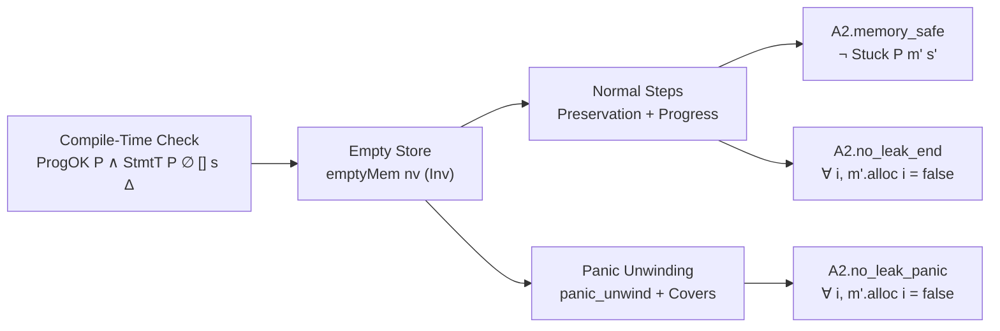

# formal — a mechanized proof of NURL's memory model

> **Status: A1 and A2 are proven** (Lean 4, no `sorry`, only Lean's
> standard axioms — `./check.sh`). The later phases are not. Until a phase
> below is marked done, the part of the guarantee in
> [`docs/MEMORY.md` §6.2](../docs/MEMORY.md) it covers rests on the
> compiler's tests (§6.6), not on a proof; and until phase C, the proof is
> about the rules, not about nurlc's implementation of them.

The goal is the statement in [`CLAIM.md`](CLAIM.md): every program the
compiler accepts outside the bodies of `unsafe` functions is memory-safe
and leak-free, data races and the panic path included — proven as a
theorem about the ownership rules, with the compiler's verdicts tied to
that theorem.

* **Visual Blueprint (GitHub):** [`BLUEPRINT.md`](BLUEPRINT.md) — Mermaid proof architecture, theorem dependency graph, `Eff.kills` invalidation lattice, and module index.
* **Interactive Explorer (`nurl-lang.org`):** [`nurl-lang.org/docs/formal-verification`](https://nurl-lang.org/docs/formal-verification) — interactive step-by-step memory & borrow-checker simulator, clickable theorem/module dependency graph, soundness-hole corpus explorer, and full Lean 4 proof browser.



## Phases

The first round proves the rules themselves (A1–A3). The trusted base and
the implementation (B–D) follow once the rules have stopped moving.

| Phase | Scope | Status |
|---|---|---|
| **A1** | Core calculus: owned values, moves and drop flags, borrows and views, a `Vec` that reallocates (§2.10), `inout`, `sink`. Single-threaded, no panics. Soundness: progress and preservation. | **done** |
| **A2** | A1 plus structs and their fields, enum and option payloads, closures and trait objects (packages: code on an environment, called through an interface) with captures by handle and by name, panics with unwinding and `recover`, the drop journal — and **leak freedom**. Generics add nothing to the memory model (a template is instantiated before it is checked). | **done** — see below for what A2 does not model yet |
| **A3** | A2 plus threads: `Send` / `Sync`, `Arc`, `Mutex`, `Locked`, `RwLocked` and its frozen read guards (`% Frozen`), `Atomic`, channels, M:N fibers, foreign functions marked `sync`. Data-race freedom against the LLVM / C11 memory model. | **A3.0 done**: threads that only move (`A3.claim`); A3.1–A3.6 designed: [`A3/DESIGN.md`](A3/DESIGN.md) |
| **B** | The standard library's `unsafe` base proven to meet the semantic types it is given: `Vec`, `String`, `HashMap`, `Rc` and the cycle collector, `Arc`, channels. | later |
| **C** | nurlc implements the rules: the compiler emits a certificate for each accepted program and a small verified checker validates it. | later |
| **D** | Code generation preserves the semantics: drop insertion, drop flags and the panic journal, by translation validation. | later |

## Layout

```
formal/
  README.md        this file
  BLUEPRINT.md     visual architecture, Mermaid theorem/module graphs, and Eff.kills lattice;
                   its counts, A2 module graph and index, and crown theorems are
                   generated (node webdocs/scripts/gen-formal-data.mjs; CI checks)
  CLAIM.md         the theorem in words, its scope per phase, and the trusted base
  RULES.md         every ownership rule of docs/MEMORY.md → its formal rule and status
  corpus/map.tsv   every hole probe → the formal rule that rejects it, or its phase,
                   and nurlc's verdict (rejected, or compiles and runs clean
                   under ASan/LSan: `tools/fuzz/holes/check.sh` finds 0 holes)
  rules/t<N>.md    RULES.md's change rows, one file per change (an ownership PR adds
                   its file, never a row of the table); tools/formal_rules.py writes
                   the table from them at release (rules/README.md)
  check.sh         builds the proof and checks it has no sorry and no new axiom
  lean-toolchain, lakefile.toml, A1.lean, A2.lean, A3.lean, Check.lean
  A1/              the A1 proof (Lean 4, core library only)
  A2/              the A2 proof, same layout, plus the modules below
  A3/              threads: DESIGN.md; Defs.lean, A3.0's semantics and claim
                   stated over A2's own step; the A3.0 proof (below)
```

### A1 — the modules

| Module | Contents |
|---|---|
| `Syntax` | types, effects (`Eff`: none ≤ realloc ≤ drop ≤ replace) and what each ends (`Eff.kills`), statements, functions and their summaries |
| `Semantics` | the store (owned trees, borrowed handles `href`, views), every step, the call (`callStmt`: parameters bound, the body renamed apart and run in their scopes); a step that would touch freed or out-of-bounds memory has no rule, so it is *stuck* |
| `Typing` | flow-sensitive contexts: each binding's mode, liveness, what it borrows from (`path`) and what its value holds (`held`); `kill` ends what an effect on a root ends; the call checked against the callee's summary (`CallT`); `FnOK` checks a body against its summary |
| `Invariant` | what a well-typed configuration guarantees of memory (`MInv`, `Inv`) |
| `Basic`, `Ctx`, `Stability`, `Heap`, `Values`, `Frame`, `Rhs`, `Steps`, `TypingFacts`, `Wf` | the invariant through each kind of step |
| `Preservation`, `Progress` | the two halves of soundness, every rule |
| `Rename` | a callee's body, typed once against its own view of its parameters, is typed where a call places it |
| `Call`, `Bind`, `CallMem`, `CallInv` | the call step: typing of the expansion, the store after binding the parameters, the invariant |
| `Soundness` | `soundness`, `memory_safe` |

The theorem, `A1.memory_safe`: for a program whose functions all check
against their summaries (`ProgOK`), a source statement well-typed in the
empty context, run from the empty store, never reaches a stuck
configuration — every reachable one has finished or can step (a failed
bounds check steps to a panic, a safe stop).

### A2 — what it adds

The same modules under `A2/`, extended, and:

| Module | Contents |
|---|---|
| `Syntax`, `Semantics`, `Typing` | structs as pairs and enums as sums with field-precise paths (`projE`, `compE`); packages (`Val.pkg`: code, an environment it owns, the captures it holds by name) for closures and trait objects, built by `pack` (`CapsOK`) and called through an interface (`callc`, `Implements`); panics unwind to the nearest `recover` (`catchR`, `letrec`) through the drop journal |
| `Panic`, `Leak` | the panic path keeps the invariant; `no_leak_end`: when a program ends, normally or by panic, nothing it allocated is still live |
| `StepFrame`, `NameWf` | the invariant through the frames a panic unwinds; what contexts hold by name stays valid |
| `Closure` | a call through a package, opened: the environment bound as a borrowed parameter, the captures as `inout` arguments of their own; the context after the opened call says no less than after the call through the package |
| `Codes` | packages name code of their signature, through every step |
| `SrcKeep` | source typing keeps every binding with its mode and type, and an anchored borrowed parameter with its entry (`StmtT.ctxRel`): what a destructor's frame needs of its body, so `letd` takes no premise for it (`srcCase`) |
| `CAPTURES_DESIGN.md` | by-name captures: the rules a closure that changes a binding is under, and why each is what the renaming lemma needs |
| `DynCell` | values owned or not per call, as the calculus has them: an owner cell the caller provides (an `inout` option the callee fills when the value is fresh) and a borrow of its payload or of the argument; the per-call function checked against its summary (`pick_ok`) and a caller run safe and leak-free by the crown theorems (`main_safe`, `main_no_leak`) |
| `DYN_DESIGN.md` | why the owner cell, how it corresponds to nurlc's ownership bit, and what phase C / D must show of it |

The theorems, `A2.memory_safe`, `A2.soundness`, `A2.no_leak_end` and
`A2.no_leak_panic` (`check.sh` prints the axioms of each).

An `inout` parameter may have any owning type — a `Vec`, a struct, an
enum, a closure (`paramOK`, `FnOK`) — and a field of a struct is replaced
in place: the struct is taken apart (`unpair`, which takes an `inout`
struct its bound lets the callee replace, as well as an owner) and
assigned again, so the replacement ends every borrow of the struct, not
only of the field — conservative, as the calculus is elsewhere. A summary
pair on an `inout` parameter with no handle of its own (a struct, an
enum, a closure) names a kind inside it (`kindFits`: `derive` makes a
handle dependency on such a root a view). These are where the 0.75.0
holes h295 (a parameter's copy passed `inout` to a function replacing one
of its fields: a copy is a borrow, never an `inout` argument,
`paramOK_inout`) and h297 (a closure replaced through an `inout`
parameter: `assign` to an `inout .replace` closure, whose slot is the
caller's) sit.

Values owned or not per call need no rule of their own. A result lent on
one path and fresh on another is, in the calculus, an owner cell and a
borrow. `DynCell` types it for a direct call. A call through a package,
which is how a trait method's result comes back, takes the cell as one
more `inout` argument the same way. A raw string that may be fresh is
the same shape over a `Vec` of bytes. That nurlc's ownership bit behaves
as the cell does is phase C / D (`A2/DYN_DESIGN.md`).

What A2 does not model yet, each a planned refinement of the calculus
rather than a gap in what it proves:

- a destructor (`% Drop`) of a type that holds views (A2-drop.2, Agora
  #224's `DtorSafe`). A destructor of a type that holds none is in the
  calculus, on the normal path and the panic path (A2-drop.1, `CLAIM.md`);
- `Rc` and its cycle collector, which are the standard library's `unsafe`
  base (phase B).

### A3.0 — threads that only move

`A3/` imports A2 and runs its own step on each thread: a thread's view of
the configuration is the shared address space (`alloc`, `nid`) with the
thread's bindings. No A2 rule is copied.

| Module | Contents |
|---|---|
| `Defs` | configurations, a thread's view and its step (`TStep`), `spawn`, what a step touches (`Touch`), a race, and the claims (`MemorySafe`, `RaceFree`, `NoLeak`, `Claim`) |
| `Frame`, `Rel` | parts of the address space (`Split`, `minus`, `union`), owned addresses (`OwnedId`, `Avoids`), and `GhostRel`: equal but for the store a `recover` frame remembers |
| `Fresh`, `BorFree`, `Owned`, `Keep` | what one step does to the address space: it allocates only fresh addresses; borrowed slots hold no address; owned trees hold only owned or fresh addresses; another part is left as it was |
| `Restrict`, `Lift` | the frame lemmas: a step on the shared address space is a step on the thread's own part (`Step.restrict`), and back (`Step.lift`) |
| `Nid`, `Ghost`, `Thread` | A2's per-thread facts (`ThreadOK`) survive a later `nid` and a remembered store with more addresses live; A2's preservation, progress and no-leak as facts of one thread on its part |
| `Touch` | every address a thread's next step touches is in one of its own trees (`touch_owned`; a `sat` through a live view by its typing) |
| `Config`, `Pres`, `SpawnPres`, `Assemble` | the configuration invariant (`CInv`: disjoint parts, A2's facts on each), its start, and that every step keeps it; `RaceFree` and `NoLeak` from it |
| `SpawnOld`, `SpawnNew` | a spawn: the spawner's side is the A2 run of `letv x (.var a) .skip; …; letv x 0 k` (the moved trees leave its part), and the new thread runs the body with its parameters' trees as its part |
| `Claim` | `A3.claim : A3.Claim` |

The theorem, `A3.claim` (`check.sh` prints its axioms): a program A2
types, whose spawned functions take only `sink` parameters of view-free
types, is memory-safe, race-free and leak-free on every interleaving.
What threads share (`Arc`, locks, `RwLocked`, atomics and channels,
library handles, globals) is A3.1–A3.6 (`A3/DESIGN.md`).

## How it relates to the rest of the repository

- [`docs/MEMORY.md`](../docs/MEMORY.md) stays the readable specification.
  Each rule in §2 gets a pointer to its formal counterpart in `RULES.md`
  as it is formalized.
- [`tools/fuzz/holes/`](../tools/fuzz/holes/) is the corpus the rules are
  checked against: every probe must be rejected by a named formal rule
  (`corpus/map.tsv`; the A2 rows name the section of `docs/MEMORY.md`
  whose rule rejects them, as `RULES.md` maps sections to rules).
- Nothing here is compiled into nurlc or the standard library. Changes
  that touch only `formal/` do not run the compiler CI jobs (see
  `.github/workflows/ci.yml`, `macos-tests.yml`, `windows-tests.yml`).
