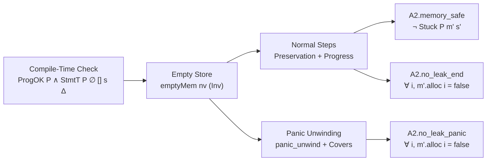

# formal — a mechanized proof of NURL's memory model

> **Status: A1, A2 and A3 are proven** (`A1.memory_safe`, `A2.memory_safe`, `A2.no_leak_end`, `A2.no_leak_panic`, `A3.claim_full`, `A3.claim_made_full` — Lean 4, no `sorry`, only Lean's
> standard axioms — `./check.sh`). Phases B–D are not. Until a phase
> below is marked done, the part of the guarantee in
> [`docs/MEMORY.md` §6.2](../docs/MEMORY.md) it covers rests on the
> compiler's tests (§6.6), not on a proof; and until phase C, the proof is
> about the rules, not about nurlc's implementation of them.

The goal is the statement in [`CLAIM.md`](CLAIM.md): every program the
compiler accepts outside the bodies of `unsafe` functions is memory-safe
and leak-free, data races and the panic path included — proven as a
theorem about the ownership rules, with the compiler's verdicts tied to
that theorem.

* **Visual Blueprint (GitHub):** [`BLUEPRINT.md`](BLUEPRINT.md) — Mermaid proof architecture, theorem dependency graph, `Eff.kills` invalidation lattice, and module index.
* **Interactive Explorer (`nurl-lang.org`):** [`nurl-lang.org/docs/formal-verification`](https://nurl-lang.org/docs/formal-verification) — interactive step-by-step memory & borrow-checker simulator, clickable theorem/module dependency graph, soundness-hole corpus explorer, and full Lean 4 proof browser.



## Phases

The first round proves the rules themselves (A1–A3). The trusted base and
the implementation (B–D) follow once the rules have stopped moving.

| Phase | Scope | Status |
|---|---|---|
| **A1** | Core calculus: owned values, moves and drop flags, borrows and views, a `Vec` that reallocates (§2.10), `inout`, `sink`. Single-threaded, no panics. Soundness: progress and preservation. | **done** |
| **A2** | A1 plus structs and their fields, enum and option payloads, closures and trait objects (packages: code on an environment, called through an interface) with captures by handle and by name, panics with unwinding and `recover`, the drop journal — and **leak freedom**. Generics add nothing to the memory model (a template is instantiated before it is checked). | **done** — see below for what A2 does not model yet |
| **A3** | A2 plus threads: `Send` / `Sync`, `Arc`, `Mutex`, `Locked`, `RwLocked` and its frozen read guards (`% Frozen`, `% NotSend`), `Atomic`, channels, library handles (`SendCheck`), closures and trait objects across threads, module globals (`make`), M:N fibers, foreign functions marked `sync`. Data-race freedom against the LLVM / C11 memory model. | **done** (`A3.claim_full`, `A3.claim_made_full`). A fiber is a thread of the model (the scheduler only picks which thread steps); a foreign function's `sync` is its author's claim, outside the proof (`CLAIM.md`). What each milestone leaves out (deadlock freedom, phase-D obligations on the runtime): [`A3/DESIGN.md`](A3/DESIGN.md), [`CLAIM.md`](CLAIM.md) |
| **B** | The standard library's `unsafe` base proven to meet the semantic types it is given: `Vec`, `String`, `HashMap`, `Rc` and the cycle collector, `Arc`, channels. | later |
| **C** | nurlc implements the rules: the compiler emits a certificate for each accepted program and a small verified checker validates it. | later |
| **D** | Code generation preserves the semantics: drop insertion, drop flags and the panic journal, by translation validation. | later |

## Layout

```
formal/
  README.md        this file
  BLUEPRINT.md     visual architecture, Mermaid theorem/module graphs, and Eff.kills lattice;
                   its counts, A2 module graph and index, and crown theorems are
                   generated (node webdocs/scripts/gen-formal-data.mjs; CI checks)
  CLAIM.md         the theorem in words, its scope per phase, and the trusted base
  RULES.md         every ownership rule of docs/MEMORY.md → its formal rule and status
  corpus/map.tsv   generated, not committed (tools/fuzz/holes/map.sh, run by build.sh):
                   every hole probe → the formal rule that rejects it, or its phase,
                   and nurlc's verdict (rejected, or compiles and runs clean
                   under ASan/LSan: `tools/fuzz/holes/check.sh` finds 0 holes)
  rules/t<N>.md    RULES.md's change rows, one file per change (an ownership PR adds
                   its file, never a row of the table); tools/formal_rules.py writes
                   the table from them at release (rules/README.md)
  check.sh         builds the proof and checks it has no sorry and no new axiom
  lean-toolchain, lakefile.toml, A1.lean, A2.lean, A3.lean, Check.lean
  A1/              the A1 proof (Lean 4, core library only)
  A2/              the A2 proof, same layout, plus the modules below
  A3/              the A3 proof (threads and data-race freedom: `A3.claim_full`, `A3.claim_made_full`; `DESIGN.md`)
```

### A1 — the modules

| Module | Contents |
|---|---|
| `Syntax` | types, effects (`Eff`: none ≤ realloc ≤ drop ≤ replace) and what each ends (`Eff.kills`), statements, functions and their summaries |
| `Semantics` | the store (owned trees, borrowed handles `href`, views), every step, the call (`callStmt`: parameters bound, the body renamed apart and run in their scopes); a step that would touch freed or out-of-bounds memory has no rule, so it is *stuck* |
| `Typing` | flow-sensitive contexts: each binding's mode, liveness, what it borrows from (`path`) and what its value holds (`held`); `kill` ends what an effect on a root ends; the call checked against the callee's summary (`CallT`); `FnOK` checks a body against its summary |
| `Invariant` | what a well-typed configuration guarantees of memory (`MInv`, `Inv`) |
| `Basic`, `Ctx`, `Stability`, `Heap`, `Values`, `Frame`, `Rhs`, `Steps`, `TypingFacts`, `Wf` | the invariant through each kind of step |
| `Preservation`, `Progress` | the two halves of soundness, every rule |
| `Rename` | a callee's body, typed once against its own view of its parameters, is typed where a call places it |
| `Call`, `Bind`, `CallMem`, `CallInv` | the call step: typing of the expansion, the store after binding the parameters, the invariant |
| `Soundness` | `soundness`, `memory_safe` |

The theorem, `A1.memory_safe`: for a program whose functions all check
against their summaries (`ProgOK`), a source statement well-typed in the
empty context, run from the empty store, never reaches a stuck
configuration — every reachable one has finished or can step (a failed
bounds check steps to a panic, a safe stop).

### A2 — what it adds

The same modules under `A2/`, extended, and:

| Module | Contents |
|---|---|
| `Syntax`, `Semantics`, `Typing` | structs as pairs and enums as sums with field-precise paths (`projE`, `compE`); packages (`Val.pkg`: code, an environment it owns, the captures it holds by name) for closures and trait objects, built by `pack` (`CapsOK`) and called through an interface (`callc`, `Implements`); panics unwind to the nearest `recover` (`catchR`, `letrec`) through the drop journal |
| `Panic`, `Leak` | the panic path keeps the invariant; `no_leak_end`: when a program ends, normally or by panic, nothing it allocated is still live |
| `StepFrame`, `NameWf` | the invariant through the frames a panic unwinds; what contexts hold by name stays valid |
| `Closure` | a call through a package, opened: the environment bound as a borrowed parameter, the captures as `inout` arguments of their own; the context after the opened call says no less than after the call through the package |
| `Codes` | packages name code of their signature, through every step |
| `SrcKeep` | source typing keeps every binding with its mode and type, and an anchored borrowed parameter with its entry (`StmtT.ctxRel`): what a destructor's frame needs of its body, so `letd` takes no premise for it (`srcCase`) |
| `CAPTURES_DESIGN.md` | by-name captures: the rules a closure that changes a binding is under, and why each is what the renaming lemma needs |
| `SweepD`, `Settle` | Agora #610: the marking sweep (an unreached `Arc` of a destructor value, or (Agora #755) of a drained `Vec` of them, marked `dead`, its payload a root) keeps the invariant; Agora #831: a block cut off from the roots together with the blocks that still refer to it (`CutOff`: none reached from the roots, an orphan to be's payload included) is a top orphan and marked (`CutOff.top`, `sweepBlkD_marks`, `Mem.sweepD_marks_cut`); the same thread's reaps after it (`Settle`, part of every step of `Steps`) can always be taken and end |
| `DynCell` | values owned or not per call, as the calculus has them: an owner cell the caller provides (an `inout` option the callee fills when the value is fresh) and a borrow of its payload or of the argument; the per-call function checked against its summary (`pick_ok`) and a caller run safe and leak-free by the crown theorems (`main_safe`, `main_no_leak`) |
| `DYN_DESIGN.md` | why the owner cell, how it corresponds to nurlc's ownership bit, and what phase C / D must show of it |

The theorems, `A2.memory_safe`, `A2.soundness`, `A2.no_leak_end` and
`A2.no_leak_panic` (`check.sh` prints the axioms of each).

An `inout` parameter may have any owning type — a `Vec`, a struct, an
enum, a closure (`paramOK`, `FnOK`) — and a field of a struct is replaced
in place: the struct is taken apart (`unpair`, which takes an `inout`
struct its bound lets the callee replace, as well as an owner) and
assigned again, so the replacement ends every borrow of the struct, not
only of the field — conservative, as the calculus is elsewhere. A summary
pair on an `inout` parameter with no handle of its own (a struct, an
enum, a closure) names a kind inside it (`kindFits`: `derive` makes a
handle dependency on such a root a view). These are where the 0.75.0
holes h295 (a parameter's copy passed `inout` to a function replacing one
of its fields: a copy is a borrow, never an `inout` argument,
`paramOK_inout`) and h297 (a closure replaced through an `inout`
parameter: `assign` to an `inout .replace` closure, whose slot is the
caller's) sit.

Values owned or not per call need no rule of their own. A result lent on
one path and fresh on another is, in the calculus, an owner cell and a
borrow. `DynCell` types it for a direct call. A call through a package,
which is how a trait method's result comes back, takes the cell as one
more `inout` argument the same way. A raw string that may be fresh is
the same shape over a `Vec` of bytes. That nurlc's ownership bit behaves
as the cell does is phase C / D (`A2/DYN_DESIGN.md`).

What A2 does not model yet, each a planned refinement of the calculus
rather than a gap in what it proves:

- of the changes of elements through a borrow (`StmtT.editB`, Agora
  #295): those whose elements hold views, a pop or a remove through a
  borrow, and the extra keeps nurlc allows beside such a
  change (two parts of one value, a whole copy beside a field viewer;
  `CLAIM.md`). A plain parameter its callee changes and a whole-handle
  copy read as `inout` and as the owner (`RULES.md`, phase C);
- a destructor run wherever a value of its type is dropped (a field, an
  element, a `sink` parameter at its callee's end, the old value of an
  `=`), not only at the end of the binding `letd` made (A2-drop.3, Agora
  #253; `CLAIM.md`, Destructors);
- `Rc` and its cycle collector, which are the standard library's `unsafe`
  base (phase B);
- leaving early: `break` and `continue` out of a loop, and a `^` before
  the end of a function's body. A2's `Stmt` has none of them. Its loop
  is left only from its head (`Step.while`, `StmtT.while`: the exit is
  the loop's invariant), and a function returns at the end of its body
  (`Fn.body`). nurlc's rules for them are therefore not yet rules of the
  calculus: a loop's exit is the join of its `break`s' states and its
  head's, except that a loop whose condition is the literal `T` and that
  has a `break` leaves only by its `break`s (`bck_loop`; Agora #413,
  #453). The refinement is an early exit as a step result beside
  `Res.panic`, caught by the innermost loop or by the call, as `catchR`
  catches a panic. Until it lands, that nurlc's rules for these exits
  agree with the calculus is part of phase C.

### A3 — threads and data-race freedom

`A3/` imports A2 and runs its own step on each thread: a thread's view of
the configuration is the shared address space (`alloc`, `nid`, `blk`, `gl`) with the
thread's bindings. No A2 rule is copied.

| Module | Contents |
|---|---|
| `Defs` | configurations, a thread's view and its step (`TStep`), `spawn`, what a step touches (`Touch`), a race, and the claims (`MemorySafe`, `RaceFree`, `NoLeak`, `Claim`; `CellAdequate`, `ClaimFull`, the stated claim) |
| `Frame`, `Rel` | parts of the address space (`Split`, `minus`, `union`), owned addresses (`OwnedId`, `Avoids`), and `GhostRel`: equal but for the store a `recover` frame remembers |
| `Fresh`, `BorFree`, `Owned`, `Keep` | what one step does to the address space: it allocates only fresh addresses; borrowed slots hold no address; owned trees hold only owned or fresh addresses; another part is left as it was |
| `Restrict`, `Lift` | the frame lemmas: a step on the shared address space is a step on the thread's own part (`Step.restrict`), and back (`Step.lift`) |
| `Nid`, `Ghost`, `Thread` | A2's per-thread facts (`ThreadOK`) survive a later `nid` and a remembered store with more addresses live; A2's preservation, progress and no-leak as facts of one thread on its part |
| `Touch` | every address a thread's next step touches is in one of its own trees (`touch_owned`; a `sat` through a live view by its typing) |
| `Config`, `Pres`, `SpawnPres`, `Assemble` | the configuration invariant (`CInv`: disjoint parts, A2's facts on each), its start, and that every step keeps it; `RaceFree` and `NoLeak` from it |
| `SpawnOld`, `SpawnNew` | a spawn: the spawner's side is the A2 run of `letv x (.var a) .skip; …; letv x 0 k` (the moved trees leave its part), and the new thread runs the body with its parameters' trees as its part |
| `Cell` | A3.5: confinement of library handles (`CellInv`: no two threads hold a share of one cell), kept by every step and by a spawn through `SendCheck`; no `CellRace` |
| `Make` | A3.6: the make phase (each global's `make` before `main`, `Made`, `make_ok`) and `A3.claim_made`: the claim from the program's global declarations, `GlobsOK` derived |
| `Claim` | `A3.claim : A3.Claim` (memory-safe, race-free, leak-free) |
| `LockDtorWitness` | Agora #755, `Locked D`: the check-out of a destructor payload gives it back at its end and on a panic (`scopeL_end_gives_back`, `scopeL_panic_gives_back`; Agora #805, for a typed frame the binding owns a `t` at the end and a `t` or nothing at every panic point: `scopeL_end_owns`, `scopeL_typed_end_gives_back`, `scopeL_typed_panic`; Agora #825: `StmtT.scopeL` carrying `x`'s liveness for every payload type, an `int` payload's `x` a plain integer binding: `frame_slot`, `release_cases`; that the block is there and checked out is `LockExcl`'s and `LockRoot`'s, Agora #808); Agora #837: a value of a type that holds no read guard and no view reaches no view (`noGuard_of_free`, `WFv.refers_noView`, `ArcIn.guard_hasGuard`), so a typed check-out's value passes the give-back's crossing check for every payload type holding no cell share, every destructor payload, shares included (`giveCheck_typed`, `giveCheck_typed_dtor`, `sendCheck_free`), the give-back lemmas above hold for those payloads with no `hasArc = false` premise (`giveable_of`, `release_cases`, `scopeL_typed_panic_give`), and no step of a typed frame is `Step.scopeLPD`'s (`scopeL_typed_panic_giveCheck`, `scopeL_typed_no_scopeLPD`); a witness made, updated through `locked_apply`, its last share dropped (`main_safe`, `main_no_leak`, `last_drop_reaps`, `A3.lockDtor_claim`); and `Locked (Vec D)`: a value pushed through the check-out, the share dropped, the reap draining the `Vec` (`mainV_safe`, `mainV_no_leak`, `last_dropV_reaps`, `reapV_drains`, `A3.lockVecDtor_claim`) |
| `LockArcDtorWitness` | Agora #803, `Locked D` where `D` holds a share (`Ty.lkPay` asks no cell share, where it asked no share): a give-back that fails its crossing check is no `Release` (`release_none`); at the check-out's end it panics with the lock held, the panic turns the frame into the value's destructor frame (`Step.scopeLPD`) and the frame's end calls the destructor, each step the only one (`scopeL_fail_end`, `scopeL_fail_frame`, `fail_frame_runs_dtor`, `fail_end_runs_dtor`): lemmas conditional on the failing check, which needs a read guard in the payload: nurlc's check, counting handle blocks only, never fails there, and since Agora #837 the model's types keep a guard out of every lock's payload (stricter than nurlc, which refuses a guard only where it crosses), so `Step.scopeLPD` is a defensive rule no typed reachable configuration takes (`A3.reach_no_scopeLPD`); a witness holding an `arc` share, made, updated through `locked_apply`, its last share dropped (`main_typed`, `main_safe`, `main_no_leak`, `main_no_leak_panic`, `last_drop_reaps`, `A3.lockArcDtor_claim`) |
| `RwDtorWitness` | Agora #804, `RwLocked D`: a read guard of a destructor payload is typed (`rwRead_dtor_typed`, `rwTryRead_dtor_typed`; Agora #837: of a type of its own, `Ty.rguard`, `% NotSend` in the types but for a spawn's parameter (refused at run time): refused in a lock's, a cell's, a channel's or an `Arc`'s payload, a global and a closure of any class but `any`, `guard_refused`, stricter than nurlc for a guard kept on its thread; a genuine `Arc` of a `(Locked U, U)` pair, `arc_pair_ok`, and a lock or an `Arc` of a `dropd` closure, `dropd_closure_ok`, are admitted): the guard's view lends the payload in place and owns nothing (`rwRead_view_lends`, `view_no_dtor`), and keeps its lock block reached while it lives (`view_keeps_lock`, `view_lock_not_cand`); Agora #831: a guard dropped after the lock's last share reaps the payload on the dropping thread, the lock block and the guard's unswept view cut off from the roots together (`view_cutOff`, `guard_drop_reaps`, `guard_drop_reaps_settle`, over `A2.CutOff` and the generalised `A3.TStep.last_drop_reaps`); a witness of an `RwLocked (Vec D)` made, read through a guard, its only share dropped while the guard is bound, then the guard (`main_typed`, `main_safe`, `main_no_leak`, `main_no_leak_panic`, `A3.rwDtor_claim`) |
| `ChanDtorWitness` | Agora #755, a channel of destructor values: its state a struct holding the queue under its glue (nurlc's `ChImpl`), one value sent and never received, the share dropped, the reap running the glue that drains the queue (`main_safe`, `main_no_leak`, `last_drop_reaps`, `reap_runs_glue`, `A3.chanDtor_claim`; Agora #805, the glue's frame steps starting the drain, element 0 to a frame of the elements' destructor: `A3.chanGlue_drains`, `glueV_drains`); a closed channel's send puts the value in a fresh lock block of its own (`closed_send_parks`), which (Agora #805) the step's marking sweep marks and the sender reaps (`A3.TStep.closed_send_reaps`, `closed_send_reaps_assign`, in `Keys`): a witness closes the channel, then sends (`mainC_safe`, `mainC_no_leak`, `A3.chanClosed_claim`, `A3.chanClosed_reaps`); and (Agora #805) one receives a destructor value, bound under the option's glue `ofnR` (`mainR_safe`, `mainR_no_leak`, `recv_runs_glue`, `ofnR_takes_payload`, `A3.chanRecv_claim`) |
| `Keys` | Agora #805: every share in a configuration a typed start reaches, in any slot (a dead borrow's too), payload or global, names a key below `nid` (`Step.keys`, `TStep.keys`, `reach_keys`); so the block a closed channel's send parks a destructor value in is marked by the step's sweep and reaped by the sending thread (`TStep.closed_send_reaps`, `reach_closed_send_reaps`; bound by `assign` too, `TStep.closed_send_reaps_assign`) |
| `LockExcl` | Agora #808, the check-outs' invariant over every reached configuration (`LockInv`, `reach_lockInv`, kept by every `TStep`): each `scopeL` frame's block a lock block of its type checked out (out, and since Agora #810 not taken: `Mem.taken` tells a block `locked_take` emptied, which only `locked_restore` fills, from one a `withLock` checked out), or gone, and the frame its only one, for every payload type (A3.2's mutual exclusion, `reach_lock_excl`); the block's state at a frame (`reach_frame_out`) |
| `LockRoot` | Agora #808, a check-out's root share outlives its body: a step leaves the slot of a binding its statement does not name that holds a share (`Step.keepSlot`, `Stmt.nm`; a package's by-name captures `inp` or a `Vec`, `CapShr`, `TypedAt.capShr`); each frame keeps a root on its thread and its block (`RootInv`, `reach_rootInv`, kept by every `TStep`; `reach_frame_root`, `reach_frame_live`, `reach_frame_checked_out`); the give-back lemmas over a `Reach` with no hypothesis on the block, for every payload type that holds no cell share (`reach_scopeL_end_gives_back`, `reach_scopeL_panic`; Agora #825: no `holdsDtor` premise; Agora #837: shares included), the give-back's crossing check passing and `Step.scopeLPD` never firing (`reach_scopeL_giveCheck`, `reach_no_scopeLPD`); a thread inside a check-out through a cell share holds an owner's share of the cell (`reach_frame_root_cell_owner`), and so (Agora #815) one inside any check-out of a cell's block (`reach_frame_cell_owner`, `reach_frame_cellOp`) |
| `Kinds` | Agora #815, no block is named by both a lock share and a cell share: a kind per key that every share in any slot (a dead borrow's too), payload or global agrees with (`CKinds`), kept by every step (`Step.kinds`, `TStep.kinds`: a constructor's fresh key, above every share, gets its share's kind) from a start whose globals agree (`GlobsKinds`, a field of `GlobsOK` since #815, left by the make phase, `make_ok`; `GlobsTyped`, what `GlobsOK` asked before, admits a start naming a key by both, `mix_globsTyped`, `mix_not_shareKind`, which `GlobsOK` refuses, `mix_not_globsOK`); `reach_shareKind`, `reach_shareKind_made`; a thread inside a check-out of a cell's block holds its cell share and an owner's share of the cell (`reach_frame_cell_owner`, `reach_frame_cellOp` in `LockRoot`, `CellOp`'s second case) |
| `ClaimFull` | Agora #818, the stated claim: `A3.claim_full : A3.ClaimFull`, `A3.claim` with race freedom adequate for cells (`CellAdequate`: every check-out of a cell's block is a `CellOp` of its thread, `reach_frame_cellOp`), and `A3.claim_made_full` (`A3.claim_made` with it, on every make's run too, `made_safe_full`). Stated beside `Claim`, not in its place, because `reach_frame_cellOp` builds on `Reap`, `Make` and the witnesses, which use `A3.claim` |
| `Mark`, `Reap` | Agora #755 item 1: the configuration's marking sweep (`Cfg.sweepD`, from every thread's slots and the globals) and the stepping thread's reaps (`CSettle`) that end `TStep.thread`; the parts, the invariant and race freedom over them (`CInv.thread_of`, `CInv.raceFree`); the reaps can always be taken and end (`reach_thread_total`); the thread that drops the last share reaps the payload (`TStep.last_drop_reaps`, since Agora #831 of a block cut off from the roots, `Cfg.sweepD_marks_cut`, so also where an unswept view still refers to it; `arcDtor_reaps`, `arcVecDtor_reaps`, `lockDtor_reaps`, `lockVecDtor_reaps`; `chanDtor_reaps` in `ChanDtorWitness`) |

The theorems, `A3.claim_full` and `A3.claim_made_full` (`check.sh` prints their axioms): a program A2
types, whose spawned functions take only `sink` parameters of view-free
types, is memory-safe, race-free and leak-free on every interleaving, and
its race freedom is adequate for cells: every check-out of a cell's block is
a step on the cell (`A3.CellAdequate`), so every two threads changing one
library handle's state are a race, which there is none of:

```lean
def ClaimFull : Prop :=
  ∀ (P : Prog) (spawn : Nat → Bool) (G : Globs) (s : Stmt) (Δ : Ctx) (nv : Nat),
    ProgOK P → ProgCodes P → SpawnOK P spawn → GlobsOK P G →
    StmtT P (fun _ => none) [] s Δ → s.src = true → s.codesOK P → (∀ v ∈ s.vars, v < nv) →
    MemorySafe P spawn (Cfg.start G s nv) ∧ RaceFree P spawn (Cfg.start G s nv) ∧
      NoLeak P spawn (Cfg.start G s nv) ∧ CellAdequate P spawn (Cfg.start G s nv)
```

(`A3.claim` and `A3.claim_made` are the same without `CellAdequate`.)
`Arc`'s frozen payloads (A3.1), `Locked` and `Mutex` values (A3.2),
`RwLocked` values and `% NotSend` / `% Frozen` guards (A3.3), `Atomic` words and channels (A3.4),
library handles with `SendCheck` plus closures and trait objects across threads (A3.5), and module globals
initialized in the `make` phase before `main` (A3.6) are all covered (`A3/DESIGN.md` and `CLAIM.md` list the remaining minor refinements).

## How it relates to the rest of the repository

- [`docs/MEMORY.md`](../docs/MEMORY.md) stays the readable specification.
  Each rule in §2 gets a pointer to its formal counterpart in `RULES.md`
  as it is formalized.
- [`tools/fuzz/holes/`](../tools/fuzz/holes/) is the corpus the rules are
  checked against: every probe must be rejected by a named formal rule
  (each probe's `// map:` line, tabled in `corpus/map.tsv`; the A2 rows
  name the section of `docs/MEMORY.md`
  whose rule rejects them, as `RULES.md` maps sections to rules).
- Nothing here is compiled into nurlc or the standard library. Changes
  that touch only `formal/` do not run the compiler CI jobs (see
  `.github/workflows/ci.yml`, `macos-tests.yml`, `windows-tests.yml`).
