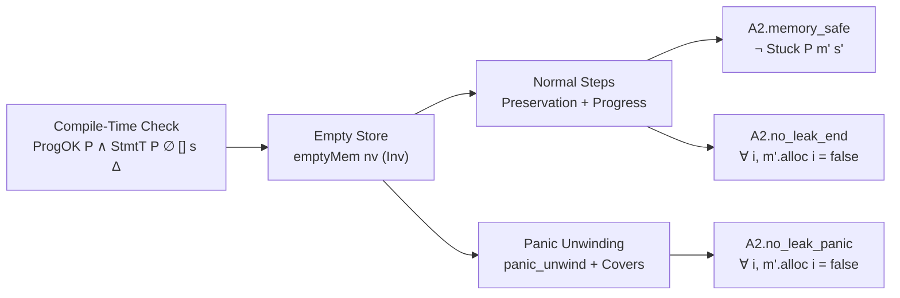

# formal — a mechanized proof of NURL's memory model

> **Status: A1, A2 and A3 are proven** (`A1.memory_safe`, `A2.memory_safe`, `A2.no_leak_end`, `A2.no_leak_panic`, `A3.claim_full`, `A3.claim_made_full` — Lean 4, no `sorry`, only Lean's
> standard axioms — `./check.sh`). Phase B: each library piece it
> names has a model of its raw code with the memory-safety theorems proven
> (B1–B9 in `B/`: `Vec`, `String`, `rcbox`, `HashMap`, `Arc`, channels,
> the cycle collector's criterion, allocation sizes, `std/rc.nu`'s `Rc`).
> The models follow the library code by inspection, and the runtime's C is
> phase D's. Phase C: an executable checker is proven sound end to end
> for A1 programs (C0–C4, `C.checked_program_safe`) and for A2 programs
> (C5–C11, `C.checked_program_safe2`: every statement form a function body
> holds (`exit` by obligations, `C/A2Exit.lean`), closure packages, destructor glue, whole programs) and for A3's
> claim (C12, `C.checked_claim_made_full`: spawned functions and globals
> decided, memory safety, race freedom and no leak on every interleaving);
> nurlc emitting the programs the checker reads is next. D is not
> started. Until a phase
> below is marked done, the part of the guarantee in
> [`docs/MEMORY.md` §6.2](../docs/MEMORY.md) it covers rests on the
> compiler's tests (§6.6), not on a proof; and until phase C, the proof is
> about the rules, not about nurlc's implementation of them.

The goal is the statement in [`CLAIM.md`](CLAIM.md): every program the
compiler accepts outside the bodies of `unsafe` functions is memory-safe
and leak-free, data races and the panic path included — proven as a
theorem about the ownership rules, with the compiler's verdicts tied to
that theorem.

* **Visual Blueprint (GitHub):** [`BLUEPRINT.md`](BLUEPRINT.md) — Mermaid proof architecture, theorem dependency graph, `Eff.kills` invalidation lattice, and module index.
* **Interactive Explorer (`nurl-lang.org`):** [`nurl-lang.org/docs/formal-verification`](https://nurl-lang.org/docs/formal-verification) — interactive step-by-step memory & borrow-checker simulator, clickable theorem/module dependency graph, soundness-hole corpus explorer, and full Lean 4 proof browser.



## Phases

The first round proves the rules themselves (A1–A3). The trusted base and
the implementation (B–D) follow once the rules have stopped moving.

| Phase | Scope | Status |
|---|---|---|
| **A1** | Core calculus: owned values, moves and drop flags, borrows and views, a `Vec` that reallocates (§2.10), `inout`, `sink`. Single-threaded, no panics. Soundness: progress and preservation. | **done** |
| **A2** | A1 plus structs and their fields, enum and option payloads, closures and trait objects (packages: code on an environment, called through an interface) with captures by handle and by name, panics with unwinding and `recover`, the drop journal — and **leak freedom**. Generics add nothing to the memory model (a template is instantiated before it is checked). | **done** — see below for what A2 does not model yet |
| **A3** | A2 plus threads: `Send` / `Sync`, `Arc`, `Mutex`, `Locked`, `RwLocked` and its frozen read guards (`% Frozen`, `% NotSend`), `Atomic`, channels, library handles (`SendCheck`), closures and trait objects across threads, module globals (`make`), M:N fibers, foreign functions marked `sync`. Data-race freedom against the LLVM / C11 memory model. | **done** (`A3.claim_full`, `A3.claim_made_full`). A fiber is a thread of the model (the scheduler only picks which thread steps); a foreign function's `sync` is its author's claim, outside the proof (`CLAIM.md`). What each milestone leaves out (deadlock freedom, phase-D obligations on the runtime): [`A3/DESIGN.md`](A3/DESIGN.md), [`CLAIM.md`](CLAIM.md) |
| **B** | The standard library's `unsafe` base proven to meet the semantic types it is given: `Vec`, `String`, `HashMap`, `Rc` and the cycle collector, `Arc`, channels. | **B1–B9 done** (`B/`, on a block heap with provenance: ids never reused, `realloc` always a fresh id). **B1 `Vec`** (`B/Vec.lean`): `vec_push` with `__vec_grow_to` / `__vec_place` / `alloc_grow_cap`, `vec_get`, the in-bounds store, `vec_pop`, `vec_insert` / `vec_remove` with their shift loops, `vec_truncate`, `vec_swap`, `vec_reserve`, `vec_append`, `vec_free`. Every operation on a represented `Vec` succeeds, touches only its live block, keeps the representation, and changes the buffer as A1's `push` / `pushRealloc` does (`B.push_refines`). A borrowed view (`cap < 0`) reads the owner's cells, and its push detaches without writing or freeing the owner's block (`B.vpush_ok`). `__vec_release_from` drops exactly the released elements, in order, whatever their destructors do to the `Vec` (`B.releaseFrom_ok`, Agora #709). **B2 `String`** (`B/String.lean`): the NUL discipline over `Vec u`, kept by `_string_seal` and `string_push_bytes` on both paths, with the source bytes arriving whole from a block never written or freed (`B.pushBytes_ok`); `string_data` reads inside the live block (`B.data_ok`). **B3 `rcbox`** (`B/Rc.lean`, behind `Shared` and every library handle): the count is the handles held; the last release drops the value once and frees the block (`B.rcRelease_ok`). **B4 `HashMap`** (`B/Map.lean`): every slot index below `cap`; a probe's found slot holds the key and its insert slot is empty or a tombstone, so `map_set` never writes over an entry; the load factor leaves an empty slot, so the probe always answers (`B.set_probe_answers`); `__map_grow` moves every entry once (`B.grow_ok`); `__map_release` drops every entry once with the map honest at each destructor (`B.release_ok`, Agora #659). **B5 `Arc`** (`B/Arc.lean`): the value is dropped at the last strong release, the block freed at the last handle of either kind, and an upgrade succeeds exactly while the value lives (`B.arcDrop_ok`, `B.upgrade_ok`). **B6 `Channel`** (`B/Channel.lean`): the queue under the lock: over any run, the values the sends accepted are, in order, the ones received and then the ones still queued (dropped with the channel), each once; a refused send hands its value back to be dropped (`B.conservation`). **B7 the cycle collector's criterion** (`B/Cycle.lean`): after trial deletion, a white block has no outside handle and every handle on it is a white block's, so freeing the white blocks together leaves no handle into them (`B.collect_safe`); the collector's walks are the runtime's C. **B8 sizes** (`B/Size.lean`): `alloc_size` and `alloc_count_add` either panic or give the true product or sum, in `i64` range: a size never wraps (`B.allocSize_ok`). **B9 `Rc`** (`B/StdRc.lean`, `std/rc.nu`): with its `Weak` handles and the `rc_take` / `rc_restore` check-out: every operation through a held handle succeeds or panics, never reaching a freed block or reading an empty slot; a read, store or take panics exactly while the value is out; the last strong release drops the value exactly when it is there, and frees the block exactly when no `Weak` is left (`B.rcDrop_ok`, agora #795); the last `Weak` frees a block no strong handle names (`B.rcWeakDrop_ok`). A packed `Vec` (elements in its control block) detaches the same way, never `realloc`ing an interior pointer (`B.packedPush_ok`). Every part of B the README names is covered; the runtime's C (`nurl_vec_drop`, the collector's walks, the atomics and locks across threads) is phase D's |
| **C** | nurlc implements the rules: the compiler emits a certificate for each accepted program and a small verified checker validates it. | **C0 done** (`C/Check.lean`): the checker's first piece, executable functions over A1's calculus. `checkExpr` / `inferRhs` / `checkStmt` decide or compute `ExprT`, `RhsT` and `StmtT` for the straight-line statements (`skip`, `seq`, `letv`, `assign`, `push`, `free`, `frozen`), each proven sound, so a program they accept is memory-safe (`C.checked_memory_safe`); they run (`decide` accepts a push-then-free and refuses a view used after a realloc). **C1 done** (`C/Join.lean`): `ite` and `while`, with every context kept inside the program's variables (`Supported`), so a join is a comparison over that finite domain (`C.eq_of_agree`); `C.checkedS_memory_safe`. **C2 done** (`C/Sub.lean`): subsumption by certificate: a certificate (`Cert`) names the contexts each `sub` step used, as finite lists, and the checker decides `Weaker` (entry by entry, then `CtxWF`) over the domain (`C.weakerB_sound`, `C.checkedC_memory_safe`). **C3 done** (`C/Call.lean`): `CallT` decided (`C.callB_sound`). **C4 done** (`C/Prog.lean`): `FnOK` / `ProgOK` decided with one certificate per function, so for A1 the chain is complete: a program whose certificates the checker accepts never gets stuck (`C.checked_program_safe`). **C5** (`C/A2Expr.lean`): A2's `ExprT` decided (`C.checkExpr2_sound`), the first piece for A2. **C6** (`C/A2Rhs.lean`): A2's core right-hand sides (moves, copies, borrows, elements, views, `pop` / `remove`), with `NoPin` and `DtorSafe` decided over the finite domain (`C.inferRhs2_sound`). **C7** (`C/A2Stmt.lean`): A2's core statements (`skip`, `seq`, `letv`, `letcall`, `assign`, `unpair`, `ite`, `while`, `push`, `free`, `frozen`, `block`, `loop`) for any exits, `EndOK` decided (`C.checkStmt2_sound`). **C8** (`C/A2Data.lean`): struct and enum right-hand sides (`pair`, field and payload reads, `inl` / `inr`, `takel` / `taker`, `C.inferRhs2d_ok`). **C9** (`C/A2Call.lean`): A2's `CallT` decided, `NamesFree` and `CallDtorSafe` included (the region premise asked unconditionally, which is sound), and `checkA2`: the statement checker with data forms and calls (`C.checkA2_sound`). **C10** (`C/A2Panic.lean`): `CtxWF` and `NameWF` decided over the domain, and `panic` in the checker: with the context unchanged, or, as an arm of an `ite`, into the other arm's context, its premises decided (`C.panicToB_sound`). Next: A2's other right-hand sides (closures, shares, regions, fresh borrows) and statements (`letd`, locks, regions, exits), then A3, then nurlc emitting the certificates (its walk's contexts) **C5–C11 done for A2** (`C/A2*.lean`): `checkA2` decides A2's `StmtT` for every statement form a function body holds, `exit` included (`checkX`, `C/A2Exit.lean`: the exits carried as obligations on the exits context, discharged at the blocks they leave; a branch that ends in an exit takes the other branch's end, `exitToB`) (`catchR` is a run-time form only, out of the checker's domain; `sub` is used by the joins: C7w, `C/A2Weaker.lean`, decides A2's `Weaker` (`C.weaker2B_sound`) and joins an `ite` whose arms end apart, a binding moved on one path only, and a loop whose round ends weaker than it began, owners rotated by assignment, in a proposed context both ends are checked to weaken to), each side condition by a decider proven sound over the finite domain (`EndOK`, `KeepOut`, `ThruOKR`/`ThruOK`/`ThruV`, `HeldOK`, `DSelf`, `DropFnOK` with the glue destructors, `¬ ThruFn` by a checked-closed set); `fnOK2B` decides `FnOK`, `progOK2B` `ProgOK` and `ProgCodes` (closure packages' `CodeOK` included), and `C.checked_program_safe2` gives A2's memory safety for a program the checker accepts. **C12 done for A3** (`C/A3Prog.lean`): A3 types programs with A2's rules; `SpawnOK` (spawned functions as a list), `DeclsOK`, `ProgGlobs` and `globsAt` are decided, and `C.checked_claim_made_full` gives A3's claim in full for a checked program. The glue alternative of `DtorParamsOK` (an enum's or a closure's glue taking its `sink` parameter apart) is decided too (`glueSelfB`). Under way (AGORA-975): nurlc's core IR translated to A2 (`tools/ncore/tolean.py`) and decided by this checker (`tools/ncore/certify.sh`): every translated hole probe agrees with nurlc on safety, and a construct the translation does not yet cover is reported, never guessed. |
| **D** | Code generation preserves the semantics: drop insertion, drop flags and the panic journal, by translation validation. | **D0 under way** (AGORA-981, `tools/ncore/tvdrops.py`, `tools/ncore/tv.sh prog.nu`): the LLVM nurlc emits, its drops validated function by function. On every path (a loop's body taken at most twice), each value a slot of the function's own frame comes to own is released or moved exactly once: it is never overwritten or left at a return while owned, and never released twice. A drop decided at run time (a per-call ownership answer) is reported unsupported, never guessed; a slot of another frame (a capture by pointer, an `inout` parameter) is that frame's to check. `tools/ncore/tv/selftest.sh` checks that it catches four codegen mistakes. **D1** (AGORA-984, `tv.sh prog.nu --journal`): the panic journal, in every function that may run under a `recover` frame (the closures handed to `recover` and what they reach, from nurlc's core IR). At each call that may panic (nurlc's own answer: inline panic points, the call graph, `--may-panic=` for runtime entries), every value the frame owns is registered (`nurl_journal_push_drop2`), none twice, none after its release; at a return nothing is left registered. Raw-pointer registrations are reported unsupported. **D2** (`formal/D/Drops.lean`): what "validated" means, proven. On a model of one path (a fresh owned store, an unowned store, a move out, `= d s`, a flag cleared, `__dropif`), the validator's abstract check (owned = flag set and not released) implies the concrete run on a heap of live blocks has no double free, no use after free and nothing left live at the return (`D.validated_safe`). **D0b** (AGORA-985, `tv.sh prog.nu --ir`, `tools/ncore/tvir.py`): the LLVM against the core IR. A named binding the IR never moves (no `use`, no literal or closure operand, no `ret`, no `sink=` / `keeps=` argument) is kept by the LLVM to its scope end: its flag is never cleared while it owns a value (a store of a value it does not own, `= out <a lend>`, is no hand-on). Bindings map to slots by name through the `--g` build's debug declarations. It found that the core IR drops `mem_forget`'s operand. Next: tying D2's path model to A2's scope ends. |

## Layout

```
formal/
  README.md        this file
  BLUEPRINT.md     visual architecture, Mermaid theorem/module graphs, and Eff.kills lattice;
                   its counts, A2 module graph and index, and crown theorems are
                   generated (node webdocs/scripts/gen-formal-data.mjs; CI checks)
  CLAIM.md         the theorem in words, its scope per phase, and the trusted base
  RULES.md         every ownership rule of docs/MEMORY.md → its formal rule and status
  corpus/map.tsv   generated, not committed (tools/fuzz/holes/map.sh, run by build.sh):
                   every hole probe → the formal rule that rejects it, or its phase,
                   and nurlc's verdict (rejected, or compiles and runs clean
                   under ASan/LSan: `tools/fuzz/holes/check.sh` finds 0 holes)
  rules/t<N>.md    RULES.md's change rows, one file per change (an ownership PR adds
                   its file, never a row of the table); tools/formal_rules.py writes
                   the table from them at release (rules/README.md)
  C.lean, C/       phase C: the verified checker (C0–C4: A1, end to end)
  B.lean, B/       phase B: the unsafe base against the rules' types (B1: `Vec`, B2: `String`, B3: `rcbox`, B4: `HashMap`, B5: `Arc`, B6: `Channel`, B7: cycle collection, B8: sizes, B9: `Rc`)
  check.sh         builds the proof and checks it has no sorry and no new axiom
  lean-toolchain, lakefile.toml, A1.lean, A2.lean, A3.lean, Check.lean
  A1/              the A1 proof (Lean 4, core library only)
  A2/              the A2 proof, same layout, plus the modules below
  A3/              the A3 proof (threads and data-race freedom: `A3.claim_full`, `A3.claim_made_full`; `DESIGN.md`)
```

### A1 — the modules

| Module | Contents |
|---|---|
| `Syntax` | types, effects (`Eff`: none ≤ realloc ≤ drop ≤ replace) and what each ends (`Eff.kills`), statements, functions and their summaries |
| `Semantics` | the store (owned trees, borrowed handles `href`, views), every step, the call (`callStmt`: parameters bound, the body renamed apart and run in their scopes); a step that would touch freed or out-of-bounds memory has no rule, so it is *stuck* |
| `Typing` | flow-sensitive contexts: each binding's mode, liveness, what it borrows from (`path`) and what its value holds (`held`); `kill` ends what an effect on a root ends; the call checked against the callee's summary (`CallT`); `FnOK` checks a body against its summary |
| `Invariant` | what a well-typed configuration guarantees of memory (`MInv`, `Inv`) |
| `Basic`, `Ctx`, `Stability`, `Heap`, `Values`, `Frame`, `Rhs`, `Steps`, `TypingFacts`, `Wf` | the invariant through each kind of step |
| `Preservation`, `Progress` | the two halves of soundness, every rule |
| `Rename` | a callee's body, typed once against its own view of its parameters, is typed where a call places it |
| `Call`, `Bind`, `CallMem`, `CallInv` | the call step: typing of the expansion, the store after binding the parameters, the invariant |
| `Soundness` | `soundness`, `memory_safe` |

The theorem, `A1.memory_safe`: for a program whose functions all check
against their summaries (`ProgOK`), a source statement well-typed in the
empty context, run from the empty store, never reaches a stuck
configuration — every reachable one has finished or can step (a failed
bounds check steps to a panic, a safe stop).

### A2 — what it adds

The same modules under `A2/`, extended, and:

| Module | Contents |
|---|---|
| `Syntax`, `Semantics`, `Typing` | structs as pairs and enums as sums with field-precise paths (`projE`, `compE`); packages (`Val.pkg`: code, an environment it owns, the captures it holds by name) for closures and trait objects, built by `pack` (`CapsOK`) and called through an interface (`callc`, `Implements`); panics unwind to the nearest `recover` (`catchR`, `letrec`) through the drop journal |
| `Panic`, `Leak` | the panic path keeps the invariant; `no_leak_end`: when a program ends, normally or by panic, nothing it allocated is still live |
| `StepFrame`, `NameWf` | the invariant through the frames a panic unwinds; what contexts hold by name stays valid |
| `Closure` | a call through a package, opened: the environment bound as a borrowed parameter, the captures as `inout` arguments of their own; the context after the opened call says no less than after the call through the package |
| `Codes` | packages name code of their signature, through every step |
| `SrcKeep` | source typing keeps every binding with its mode and type, and an anchored borrowed parameter with its entry (`StmtT.ctxRel`): what a destructor's frame needs of its body, so `letd` takes no premise for it (`srcCase`) |
| `CAPTURES_DESIGN.md` | by-name captures: the rules a closure that changes a binding is under, and why each is what the renaming lemma needs |
| `SweepD`, `Settle` | Agora #610: the marking sweep (an unreached `Arc` of a destructor value, or (Agora #755) of a drained `Vec` of them, marked `dead`, its payload a root) keeps the invariant; Agora #831: a block cut off from the roots together with the blocks that still refer to it (`CutOff`: none reached from the roots, an orphan to be's payload included) is a top orphan and marked (`CutOff.top`, `sweepBlkD_marks`, `Mem.sweepD_marks_cut`); the same thread's reaps after it (`Settle`, part of every step of `Steps`) can always be taken and end |
| `DynCell` | values owned or not per call, as the calculus has them: an owner cell the caller provides (an `inout` option the callee fills when the value is fresh) and a borrow of its payload or of the argument; the per-call function checked against its summary (`pick_ok`) and a caller run safe and leak-free by the crown theorems (`main_safe`, `main_no_leak`) |
| `DYN_DESIGN.md` | why the owner cell, how it corresponds to nurlc's ownership bit, and what phase C / D must show of it |
| `RemoveLoopWitness` | AGORA-889: `vec_remove b i` of a number through a `vec_at` borrow at a general index, as a `while` loop of element sets one place down and the truncation, typed for every index `i` (the loop's body keeps its context, `LoopCtx`, `step_typed`), with memory_safe and no_leak_end applied (`main_safe i`, `main_no_leak i`). A witness program, not a rule |
| `TakeB` | AGORA-889: an element that owns memory moved out through a borrow (`Stmt.takeB`, `editSet`'s reverse): the owner's tree loses it in place (`HeapOK.editTake`, `MInv.editB_take`, typed as `editB`'s truncation), the new owner takes it (`takeB_outOwn`, `covers_takeB`; `takeB_pres` in `Preservation`). AGORA-897: the same for an element type that holds views (`StmtT.takeBV`: `MInv.editBV_take`, typed as `editBV`'s truncation; the element's views stay valid, `takeB_viewsOK`, `takeBV_out`; `takeBV_pres`). A rule of the calculus |
| `TakeBWitness` | AGORA-889: a String popped and one removed through a `vec_at` borrow of a `Vec` of `Vec`s of Strings, both kept and read (`Stmt.takeB`), typed and run safe and leak-free (`main_typed`, `main_safe`, `main_no_leak`). A witness program |
| `TakeBDWitness` | AGORA-900: a destructor value popped through a `vec_at` borrow of a `letd` `Vec` of `Vec`s of them and handed to its own `letd` first thing (`StmtT.takeB`, the typing's guarantee `A2.Dtor.takeB_typed`), typed on `DtorWitness`'s program and run safe and leak-free (`main12_typed`, `main12_safe`, `main12_no_leak`). A witness program |
| `TakeBVWitness` | AGORA-897: two views of a String's buffer, one popped and one removed through a `vec_at` borrow of a `Vec` of `Vec`s of views, both kept and read through their views (`StmtT.takeBV`), typed and run safe and leak-free (`main_typed`, `main_safe`, `main_no_leak`); AGORA-898: a closure whose environment is a view moved out the same way (`main2_typed`, `main2_safe`, `main2_no_leak`). A witness program |
| `PopWitness` | AGORA-888: a pop and a remove through a borrow, read as the steps the calculus has: the truncation to the last index (`Expr.dec`, a saturating decrement), the number read before it, and element sets one place down for a remove; through a `vec_at` borrow of a `Vec` of `Vec`s and through a cursor (an element `Vec` dropped), typed and run safe and leak-free (`main_safe`, `main_no_leak`) |
| `HandOver` | AGORA-885: nurlc's by-name hand-over of an owner's old value to the binding that reads it (`= o other`, then `= other …`), as an encoding: the reader is an owner cell and a borrow, and the hand-over a `take` into the cell. Straight-line (`main_safe`, `main_no_leak`) and decided at run time by a flag, nurlc's buffer test (`mainJ_safe c`, `mainJ_no_leak c`, for every value `c` of the condition). Two witness programs; no general translation yet |
| `HANDOVER_DESIGN.md` | the encoding against nurlc's drop flags and borrower list, what phase C / D must show of it, and the hand-overs it leaves out |
| `TakeWitness` | Agora #826: a take out of an `inout .replace` place (`RhsT.take`: the `Vec` moves out, the place keeps a fresh empty one and stays live), nurlc's hand-over of an `inout` handle parameter: the callee checked against its summary (`g_ok`), and a caller that reads its argument after the call run safe and leak-free (`main_safe`, `main_no_leak`) |
| `TAKE_DESIGN.md` | the take's step and typing, why its `Vec`'s elements hold no view, and how each part of the proof covers it |
| `THRU_LIFT_DESIGN.md` | why a through-changing callee called with an argument holding views is not typed yet (AGORA-932): the coarse lift, the kinds that do not compose, the provenance a move erases, and what typing it would take |
| `ExitWitness` | Agora #871, the early exits: a `break` out of a `while T` from inside a scope whose owned `Vec` the exit drops (`mainB_typed`, `breakB_steps`, `mainB_safe`, `mainB_no_leak`); a `continue`-shaped exit of a loop body's block, the loop left from its head (`mainC_safe`, `mainC_no_leak`); and a `^` from inside a scope of a callee, checked against its summary (`gR_ok`, `returnR_steps`), with its caller run safe and leak-free (`mainR_safe`, `mainR_no_leak`) |
| `Layout` | Agora #879: a tree's addresses are its nodes' control blocks and buffers (`ctls_datas_perm`), and the control block of a node of any tree the store owns, a slot's or a block's payload, is not the buffer of a node of any tree it owns (`ctl_ne_data`, from `HeapOK` and `BlkOwn`): the fact nurlc's `nurl vec ctl` / `nurl vec elem` TBAA tags assert |

The theorems, `A2.memory_safe`, `A2.soundness`, `A2.no_leak_end` and
`A2.no_leak_panic` (`check.sh` prints the axioms of each).

An `inout` parameter may have any owning type — a `Vec`, a struct, an
enum, a closure (`paramOK`, `FnOK`) — and a field of a struct is replaced
in place: the struct is taken apart (`unpair`, which takes an `inout`
struct its bound lets the callee replace, as well as an owner) and
assigned again, so the replacement ends every borrow of the struct, not
only of the field — conservative, as the calculus is elsewhere. A summary
pair on an `inout` parameter with no handle of its own (a struct, an
enum, a closure) names a kind inside it (`kindFits`: `derive` makes a
handle dependency on such a root a view). These are where the 0.75.0
holes h295 (a parameter's copy passed `inout` to a function replacing one
of its fields: a copy is a borrow, never an `inout` argument,
`paramOK_inout`) and h297 (a closure replaced through an `inout`
parameter: `assign` to an `inout .replace` closure, whose slot is the
caller's) sit.

Values owned or not per call need no rule of their own. A result lent on
one path and fresh on another is, in the calculus, an owner cell and a
borrow. `DynCell` types it for a direct call. A call through a package,
which is how a trait method's result comes back, takes the cell as one
more `inout` argument the same way. A raw string that may be fresh is
the same shape over a `Vec` of bytes. That nurlc's ownership bit behaves
as the cell does is phase C / D (`A2/DYN_DESIGN.md`).

An owner's old value handed over to the binding that reads it by name
(`= o other`, then `= other …`) is the same encoding (`HandOver`, AGORA-885).
The reader is an owner cell and a borrow, and the hand-over is a `take` of
the old value into the cell (`A2/HANDOVER_DESIGN.md`).

What A2 does not model yet, each a planned refinement of the calculus
rather than a gap in what it proves:

- of the changes of elements through a borrow (`StmtT.editB`, Agora
  #295): those whose elements hold views (a pop or a remove through a
  borrow whose element is dropped, or is a number, is a truncation and
  element sets, `A2/PopWitness.lean`, AGORA-888; one whose element owns
  memory and is kept is `Stmt.takeB`, AGORA-889, also when its type
  holds views, AGORA-897), and the extra keeps nurlc allows beside such a
  change (two parts of one value, a whole copy beside a field viewer;
  `CLAIM.md`). A plain parameter its callee changes and a whole-handle
  copy read as `inout` and as the owner (`RULES.md`, phase C);
- a destructor run wherever a value of its type is dropped (a field, an
  element, a `sink` parameter at its callee's end, the old value of an
  `=`), not only at the end of the binding `letd` made (A2-drop.3, Agora
  #253; `CLAIM.md`, Destructors);
- `Rc` and its cycle collector, which are the standard library's `unsafe`
  base (phase B);

Leaving early (Agora #871) is in the calculus. A block (`Stmt.block`) is
what an `exit n` leaves: it jumps out of `n + 1` blocks in one step
(`ExitAt`, `Step.blockExit`), and every scope it leaves ends on the way,
its drops and destructors run as at the scope's own end. A `break` is an
`exit` of the block around its loop, a `continue` of the block around
the loop's body, and a `^` sets the result slot and exits the block that
is the function's body. `while T` is `Stmt.loop`, left only by its
exits. Typing carries the exits a statement may take (`StmtT`'s `Exits`
index): an `exit` is typed where every scope it leaves can end
(`Exits.under`, `Exits.underD`), and the block's end, its body's end,
says no more than the context each exit leaves from (`Exits.blk`,
`Weaker`). So a block's end is a join of its exits' states
and its body's, and a `while T`'s of its exits' only, as nurlc's
`bck_loop` has it (Agora #413, #453).

The frames that are not scopes take no exits: a `recover` (`catchR`), a
borrow's or a freeze's frame (`rbind`, `frozen`), a lock's check-out
(`withLock`, `scopeL`) and an element's hand-over (`withElem`, `insert`)
are typed with `Exits.none`. In NURL source there is no exit that could
cross one: each holds a call (`recover f`, `locked_update a f`,
`( f ( vec_at v i ) )`), or, at run time, a callee's body, whose own
exits are its body block's. The one way source put a jump across a call
frame was a `break` or `continue` in a closure literal written inside a
loop; nurlc emitted a branch to the enclosing function's loop label and
clang refused the module. nurlc now refuses it with a diagnostic, so its
rule is the calculus's (Agora #871, `compiler/tests/diag_break_in_closure_body.nu`).
nurlc's exits end the scopes they leave as `Step.blockExit` does,
innermost first, each destructor once
(`compiler/tests/exits_drop_each_scope_once.nu`). That nurlc's rules for
the exits agree with these in full is part of phase C.

### A3 — threads and data-race freedom

`A3/` imports A2 and runs its own step on each thread: a thread's view of
the configuration is the shared address space (`alloc`, `nid`, `blk`, `gl`) with the
thread's bindings. No A2 rule is copied.

| Module | Contents |
|---|---|
| `Defs` | configurations, a thread's view and its step (`TStep`), `spawn`, what a step touches (`Touch`), a race, and the claims (`MemorySafe`, `RaceFree`, `NoLeak`, `Claim`; `CellAdequate`, `ClaimFull`, the stated claim) |
| `Frame`, `Rel` | parts of the address space (`Split`, `minus`, `union`), owned addresses (`OwnedId`, `Avoids`), and `GhostRel`: equal but for the store a `recover` frame remembers |
| `Fresh`, `BorFree`, `Owned`, `Keep` | what one step does to the address space: it allocates only fresh addresses; borrowed slots hold no address; owned trees hold only owned or fresh addresses; another part is left as it was |
| `Restrict`, `Lift` | the frame lemmas: a step on the shared address space is a step on the thread's own part (`Step.restrict`), and back (`Step.lift`) |
| `Nid`, `Ghost`, `Thread` | A2's per-thread facts (`ThreadOK`) survive a later `nid` and a remembered store with more addresses live; A2's preservation, progress and no-leak as facts of one thread on its part |
| `Touch` | every address a thread's next step touches is in one of its own trees (`touch_owned`; a `sat` through a live view by its typing) |
| `Config`, `Pres`, `SpawnPres`, `Assemble` | the configuration invariant (`CInv`: disjoint parts, A2's facts on each), its start, and that every step keeps it; `RaceFree` and `NoLeak` from it |
| `SpawnOld`, `SpawnNew` | a spawn: the spawner's side is the A2 run of `letv x (.var a) .skip; …; letv x 0 k` (the moved trees leave its part), and the new thread runs the body with its parameters' trees as its part |
| `Cell` | A3.5: confinement of library handles (`CellInv`: no two threads hold a share of one cell), kept by every step and by a spawn through `SendCheck`; no `CellRace` |
| `Make` | A3.6: the make phase (each global's `make` before `main`, `Made`, `make_ok`) and `A3.claim_made`: the claim from the program's global declarations, `GlobsOK` derived |
| `Claim` | `A3.claim : A3.Claim` (memory-safe, race-free, leak-free) |
| `LockDtorWitness` | Agora #755, `Locked D`: the check-out of a destructor payload gives it back at its end and on a panic (`scopeL_end_gives_back`, `scopeL_panic_gives_back`; Agora #805, for a typed frame the binding owns a `t` at the end and a `t` or nothing at every panic point: `scopeL_end_owns`, `scopeL_typed_end_gives_back`, `scopeL_typed_panic`; Agora #825: `StmtT.scopeL` carrying `x`'s liveness for every payload type, an `int` payload's `x` a plain integer binding: `frame_slot`, `release_cases`; that the block is there and checked out is `LockExcl`'s and `LockRoot`'s, Agora #808); Agora #837: a value of a type that holds no read guard and no view reaches no view (`noGuard_of_free`, `WFv.refers_noView`, `ArcIn.guard_hasGuard`), so a typed check-out's value passes the give-back's crossing check for every payload type holding no cell share, every destructor payload, shares included (`giveCheck_typed`, `giveCheck_typed_dtor`, `sendCheck_free`), the give-back lemmas above hold for those payloads with no `hasArc = false` premise (`giveable_of`, `release_cases`, `scopeL_typed_panic_give`), and no step of a typed frame is `Step.scopeLPD`'s (`scopeL_typed_panic_giveCheck`, `scopeL_typed_no_scopeLPD`); a witness made, updated through `locked_apply`, its last share dropped (`main_safe`, `main_no_leak`, `last_drop_reaps`, `A3.lockDtor_claim`); and `Locked (Vec D)`: a value pushed through the check-out, the share dropped, the reap draining the `Vec` (`mainV_safe`, `mainV_no_leak`, `last_dropV_reaps`, `reapV_drains`, `A3.lockVecDtor_claim`) |
| `LockArcDtorWitness` | Agora #803, `Locked D` where `D` holds a share (`Ty.lkPay` asks no cell share, where it asked no share): a give-back that fails its crossing check is no `Release` (`release_none`); at the check-out's end it panics with the lock held, the panic turns the frame into the value's destructor frame (`Step.scopeLPD`) and the frame's end calls the destructor, each step the only one (`scopeL_fail_end`, `scopeL_fail_frame`, `fail_frame_runs_dtor`, `fail_end_runs_dtor`): lemmas conditional on the failing check, which needs a read guard in the payload: nurlc's check, counting handle blocks only, never fails there, and since Agora #837 the model's types keep a guard out of every lock's payload (stricter than nurlc, which refuses a guard only where it crosses), so `Step.scopeLPD` is a defensive rule no typed reachable configuration takes (`A3.reach_no_scopeLPD`); a witness holding an `arc` share, made, updated through `locked_apply`, its last share dropped (`main_typed`, `main_safe`, `main_no_leak`, `main_no_leak_panic`, `last_drop_reaps`, `A3.lockArcDtor_claim`) |
| `RwDtorWitness` | Agora #804, `RwLocked D`: a read guard of a destructor payload is typed (`rwRead_dtor_typed`, `rwTryRead_dtor_typed`; Agora #837: of a type of its own, `Ty.rguard`, `% NotSend` in the types but for a spawn's parameter (refused at run time): refused in a lock's, a cell's, a channel's or an `Arc`'s payload, a global and a closure of any class but `any`, `guard_refused`, stricter than nurlc for a guard kept on its thread; a genuine `Arc` of a `(Locked U, U)` pair, `arc_pair_ok`, and a lock or an `Arc` of a `dropd` closure, `dropd_closure_ok`, are admitted): the guard's view lends the payload in place and owns nothing (`rwRead_view_lends`, `view_no_dtor`), and keeps its lock block reached while it lives (`view_keeps_lock`, `view_lock_not_cand`); Agora #831: a guard dropped after the lock's last share reaps the payload on the dropping thread, the lock block and the guard's unswept view cut off from the roots together (`view_cutOff`, `guard_drop_reaps`, `guard_drop_reaps_settle`, over `A2.CutOff` and the generalised `A3.TStep.last_drop_reaps`); a witness of an `RwLocked (Vec D)` made, read through a guard, its only share dropped while the guard is bound, then the guard (`main_typed`, `main_safe`, `main_no_leak`, `main_no_leak_panic`, `A3.rwDtor_claim`) |
| `ChanDtorWitness` | Agora #755, a channel of destructor values: its state a struct holding the queue under its glue (nurlc's `ChImpl`), one value sent and never received, the share dropped, the reap running the glue that drains the queue (`main_safe`, `main_no_leak`, `last_drop_reaps`, `reap_runs_glue`, `A3.chanDtor_claim`; Agora #805, the glue's frame steps starting the drain, element 0 to a frame of the elements' destructor: `A3.chanGlue_drains`, `glueV_drains`); a closed channel's send puts the value in a fresh lock block of its own (`closed_send_parks`), which (Agora #805) the step's marking sweep marks and the sender reaps (`A3.TStep.closed_send_reaps`, `closed_send_reaps_assign`, in `Keys`): a witness closes the channel, then sends (`mainC_safe`, `mainC_no_leak`, `A3.chanClosed_claim`, `A3.chanClosed_reaps`); and (Agora #805) one receives a destructor value, bound under the option's glue `ofnR` (`mainR_safe`, `mainR_no_leak`, `recv_runs_glue`, `ofnR_takes_payload`, `A3.chanRecv_claim`) |
| `Keys` | Agora #805: every share in a configuration a typed start reaches, in any slot (a dead borrow's too), payload or global, names a key below `nid` (`Step.keys`, `TStep.keys`, `reach_keys`); so the block a closed channel's send parks a destructor value in is marked by the step's sweep and reaped by the sending thread (`TStep.closed_send_reaps`, `reach_closed_send_reaps`; bound by `assign` too, `TStep.closed_send_reaps_assign`) |
| `LockExcl` | Agora #808, the check-outs' invariant over every reached configuration (`LockInv`, `reach_lockInv`, kept by every `TStep`): each `scopeL` frame's block a lock block of its type checked out (out, and since Agora #810 not taken: `Mem.taken` tells a block `locked_take` emptied, which only `locked_restore` fills, from one a `withLock` checked out), or gone, and the frame its only one, for every payload type (A3.2's mutual exclusion, `reach_lock_excl`); the block's state at a frame (`reach_frame_out`) |
| `LockRoot` | Agora #808, a check-out's root share outlives its body: a step leaves the slot of a binding its statement does not name that holds a share (`Step.keepSlot`, `Stmt.nm`; a package's by-name captures `inp` or a `Vec`, `CapShr`, `TypedAt.capShr`); each frame keeps a root on its thread and its block (`RootInv`, `reach_rootInv`, kept by every `TStep`; `reach_frame_root`, `reach_frame_live`, `reach_frame_checked_out`); the give-back lemmas over a `Reach` with no hypothesis on the block, for every payload type that holds no cell share (`reach_scopeL_end_gives_back`, `reach_scopeL_panic`; Agora #825: no `holdsDtor` premise; Agora #837: shares included), the give-back's crossing check passing and `Step.scopeLPD` never firing (`reach_scopeL_giveCheck`, `reach_no_scopeLPD`); a thread inside a check-out through a cell share holds an owner's share of the cell (`reach_frame_root_cell_owner`), and so (Agora #815) one inside any check-out of a cell's block (`reach_frame_cell_owner`, `reach_frame_cellOp`) |
| `Kinds` | Agora #815, no block is named by both a lock share and a cell share: a kind per key that every share in any slot (a dead borrow's too), payload or global agrees with (`CKinds`), kept by every step (`Step.kinds`, `TStep.kinds`: a constructor's fresh key, above every share, gets its share's kind) from a start whose globals agree (`GlobsKinds`, a field of `GlobsOK` since #815, left by the make phase, `make_ok`; `GlobsTyped`, what `GlobsOK` asked before, admits a start naming a key by both, `mix_globsTyped`, `mix_not_shareKind`, which `GlobsOK` refuses, `mix_not_globsOK`); `reach_shareKind`, `reach_shareKind_made`; a thread inside a check-out of a cell's block holds its cell share and an owner's share of the cell (`reach_frame_cell_owner`, `reach_frame_cellOp` in `LockRoot`, `CellOp`'s second case) |
| `ClaimFull` | Agora #818, the stated claim: `A3.claim_full : A3.ClaimFull`, `A3.claim` with race freedom adequate for cells (`CellAdequate`: every check-out of a cell's block is a `CellOp` of its thread, `reach_frame_cellOp`), and `A3.claim_made_full` (`A3.claim_made` with it, on every make's run too, `made_safe_full`). Stated beside `Claim`, not in its place, because `reach_frame_cellOp` builds on `Reap`, `Make` and the witnesses, which use `A3.claim` |
| `Mark`, `Reap` | Agora #755 item 1: the configuration's marking sweep (`Cfg.sweepD`, from every thread's slots and the globals) and the stepping thread's reaps (`CSettle`) that end `TStep.thread`; the parts, the invariant and race freedom over them (`CInv.thread_of`, `CInv.raceFree`); the reaps can always be taken and end (`reach_thread_total`); the thread that drops the last share reaps the payload (`TStep.last_drop_reaps`, since Agora #831 of a block cut off from the roots, `Cfg.sweepD_marks_cut`, so also where an unswept view still refers to it; `arcDtor_reaps`, `arcVecDtor_reaps`, `lockDtor_reaps`, `lockVecDtor_reaps`; `chanDtor_reaps` in `ChanDtorWitness`) |

The theorems, `A3.claim_full` and `A3.claim_made_full` (`check.sh` prints their axioms): a program A2
types, whose spawned functions take only `sink` parameters of view-free
types, is memory-safe, race-free and leak-free on every interleaving, and
its race freedom is adequate for cells: every check-out of a cell's block is
a step on the cell (`A3.CellAdequate`), so every two threads changing one
library handle's state are a race, which there is none of:

```lean
def ClaimFull : Prop :=
  ∀ (P : Prog) (spawn : Nat → Bool) (G : Globs) (s : Stmt) (Δ : Ctx) (nv : Nat),
    ProgOK P → ProgCodes P → SpawnOK P spawn → GlobsOK P G →
    StmtT P (fun _ => none) [] s Δ → s.src = true → s.codesOK P → (∀ v ∈ s.vars, v < nv) →
    MemorySafe P spawn (Cfg.start G s nv) ∧ RaceFree P spawn (Cfg.start G s nv) ∧
      NoLeak P spawn (Cfg.start G s nv) ∧ CellAdequate P spawn (Cfg.start G s nv)
```

(`A3.claim` and `A3.claim_made` are the same without `CellAdequate`.)
`Arc`'s frozen payloads (A3.1), `Locked` and `Mutex` values (A3.2),
`RwLocked` values and `% NotSend` / `% Frozen` guards (A3.3), `Atomic` words and channels (A3.4),
library handles with `SendCheck` plus closures and trait objects across threads (A3.5), and module globals
initialized in the `make` phase before `main` (A3.6) are all covered (`A3/DESIGN.md` and `CLAIM.md` list the remaining minor refinements).

## How it relates to the rest of the repository

- [`docs/MEMORY.md`](../docs/MEMORY.md) stays the readable specification.
  Each rule in §2 gets a pointer to its formal counterpart in `RULES.md`
  as it is formalized.
- [`tools/fuzz/holes/`](../tools/fuzz/holes/) is the corpus the rules are
  checked against: every probe must be rejected by a named formal rule
  (each probe's `// map:` line, tabled in `corpus/map.tsv`; the A2 rows
  name the section of `docs/MEMORY.md`
  whose rule rejects them, as `RULES.md` maps sections to rules).
- Nothing here is compiled into nurlc or the standard library. Changes
  that touch only `formal/` do not run the compiler CI jobs (see
  `.github/workflows/ci.yml`, `macos-tests.yml`, `windows-tests.yml`).
